# Dreamcloud

一台掌心大的小裝置，我們還在慢慢把它做好。  
A pocket-size device. We are still building it.

**基於 / Based on** [Waveshare ESP32-S3-Touch-AMOLED-1.75C](https://docs.waveshare.com/ESP32-S3-Touch-AMOLED-1.75C)

Dreamcloud 跑在微雪這塊 1.75 吋圓形 AMOLED 開發板上。板子是 Waveshare 的；Dreamcloud 是我們在上面做的隨身介面。  
Dreamcloud runs on Waveshare's 1.75-inch round AMOLED board. The board is theirs. Dreamcloud is the pocket interface we are building on it.

**官網 / Website：** [https://dreamcloud.ccwu.cc/](https://dreamcloud.ccwu.cc/)  
**討論區 / Forum：** [https://dreamcloud.ccwu.cc/forum/](https://dreamcloud.ccwu.cc/forum/)

[中文](#中文) · [English](#english)

它還在開發中。這個儲存庫目前先放專案介紹、實機畫面和 App 圖示，**韌體原始碼尚未放上**。  
Still in development. This repository currently holds the introduction, device screenshots, and app icons. **Firmware source is not published yet.**

  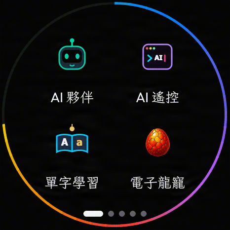
  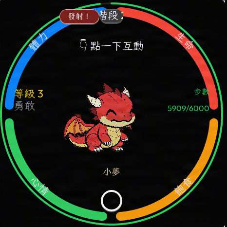
  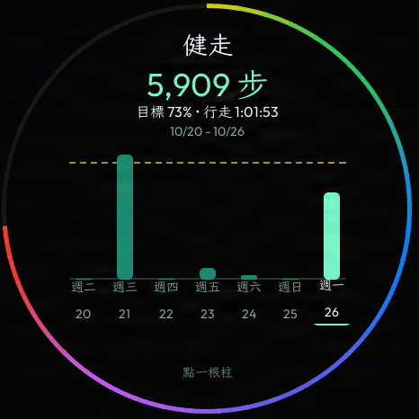
  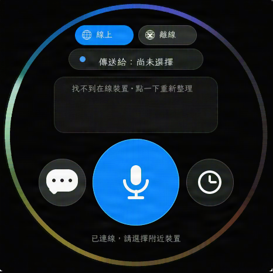

## 中文

Dreamcloud 有一塊不到兩吋的圓形 AMOLED 螢幕，內建麥克風和喇叭。裡面住著一隻會長大的小龍；想問問題，或把待辦交給電腦上的 AI 助理，按住說話就好。

每天改了什麼、接下來做什麼，以及收集意見，都在[官網](https://dreamcloud.ccwu.cc/)。

### 官網

每一區都有自己的頁面，挑有興趣的看就好。

| | 頁面 | 內容 |
| --- | --- | --- |
| 01 | [龍寵](https://dreamcloud.ccwu.cc/dragon/) | 從龍蛋養到滅世龍，還有體感飛行和對戰 |
| 02 | [AI 夥伴與 AI 遙控](https://dreamcloud.ccwu.cc/ai/) | 跟 AI 說話；把一句話變成交給電腦上 AI 助理的任務 |
| 03 | [計步與健走](https://dreamcloud.ccwu.cc/steps/) | 今日步數圓環、7 天曲線、每天的行走分析 |
| 04 | [遊戲](https://dreamcloud.ccwu.cc/games/) | 小精靈、橋上跑者、炸彈人、猜拳、井字；鍵盤或手機能當手把 |
| 05 | [其他 App](https://dreamcloud.ccwu.cc/apps/) | 即時通、對講機、單字學習、注音輸入、家長模式和日常工具 |
| 06 | [更新與開發進度](https://dreamcloud.ccwu.cc/updates/) | 每天改了什麼、接下來做什麼、常見問題 |
| 07 | [討論區](https://dreamcloud.ccwu.cc/forum/) | 回報 Bug、問問題、改善建議、許願 |

不到兩吋圓形 AMOLED ・ 麥克風與喇叭 ・ Wi‑Fi ・ 體感與計步 ・ 繁中、注音、English ・ 家長模式

### 裡面有什麼

#### 龍寵

每天照顧牠一下，牠就會慢慢長大。餵食、睡覺、長按抱抱；生命、飽食、心情、體力會跟著變化。六個階段是龍蛋、幼龍、成長龍、青年龍、成年龍、滅世龍。每隻有自己的個性、等級和進化階段。

傾斜裝置可以飛過天空和森林關卡。也可以和 NPC 飛龍對決；待在主畫面時，收得到朋友的對戰邀請。

孵化之後可以跟龍說話。在主畫面按住說話，牠會聽完再用語音回你。這條語音走電腦端，需要網路，不是在裝置上離線跑的。龍還是蛋，或正在飛行、對戰時，先不能對話。AI 夥伴仍然是另一個 App。

[到官網看龍寵 →](https://dreamcloud.ccwu.cc/dragon/)

  
  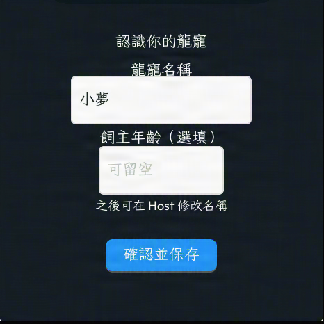
  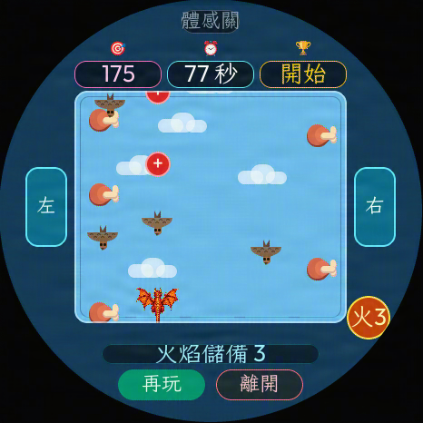
  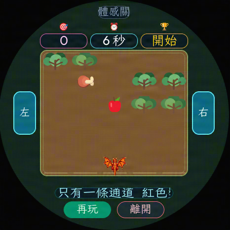
  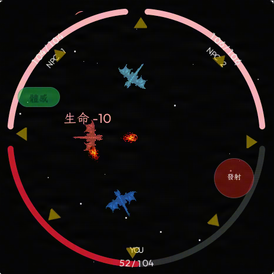

#### AI 夥伴與 AI 遙控

AI 夥伴陪你聊天：按住說話，角色會聆聽、思考，再用語音回你。可以連接你選的主流 AI 服務，聲音有台灣口音、美式英文和英式英文。網路語音不能用時會自動換備援；一句回應講到一半也不會換聲音。

AI 遙控把一句話變成交給電腦上 AI 助理的任務。選助理、用語音或注音輸入、確認送出。等的時候看光環；完成後可以讀回覆，或聽語音摘要。只列出電腦上裝好的助理。預設需要配對碼，自己家的網路可以關掉。離開畫面後，回覆會用訊息泡泡通知。

AI 不是在裝置上離線跑的。需要網路、電腦端配套程式，和你自己的 AI 帳號。

[到官網看 AI →](https://dreamcloud.ccwu.cc/ai/)

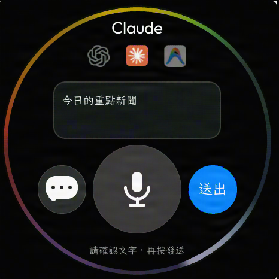

#### 計步與健走

戴手腕或放口袋都能計。感測器暫時沒抓到時，會自動換另一種方法計。啟動器外圈有今日步數圓環，導覽列也會顯示步數。計步和每日目標可以分開設定。行走時間只算連續走路。

健走 App 有最近 7 天的步數長條圖。點一天可以看步數、連續行走時間、估計距離、目標達成率，以及每小時分布。距離是估計值。

[到官網看計步 →](https://dreamcloud.ccwu.cc/steps/)

  
  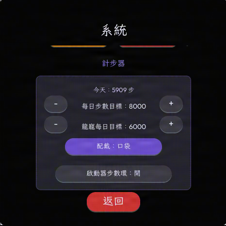

#### 遊戲

小精靈的嘴巴朝移動方向開合，傾斜或滑動都能操控，可以提前輸入下一個轉彎。每局開始有倒數，迷宮是橘金色霓虹，背景音樂是原創的。

橋上跑者可以自己玩，也能邀請附近另一支裝置一起過橋。有章節、上下層平台和檢查點，進度會留到下次。

另外還有炸彈人、猜拳、井字。電腦鍵盤或 Android 手機可以當手把，炸彈人、龍之對決、龍之地圖、小精靈都接得上。

[到官網看遊戲 →](https://dreamcloud.ccwu.cc/games/)

  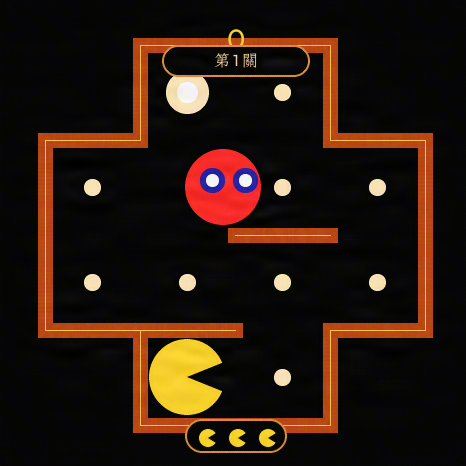
  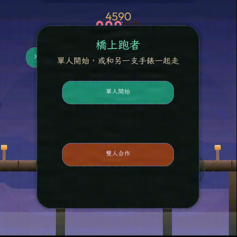
  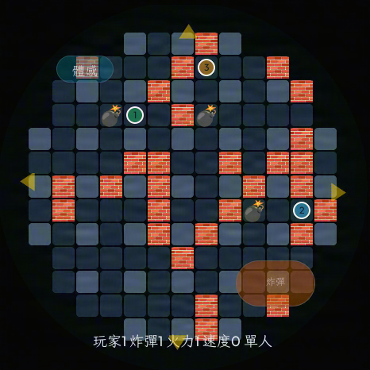
  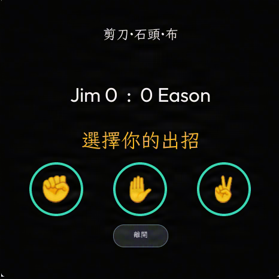
  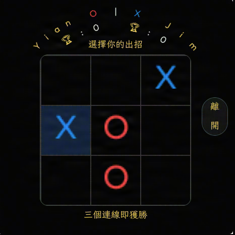

#### 其他 App

- **即時通：** 按住說話傳訊。可以接 LINE、Telegram、Discord、Slack、WhatsApp、企業微信或 FB Messenger，在電腦端或 Android 端選。
- **對講機：** 選附近的好友，按住說話，也能傳文字。
- **單字學習：** 文字和注音一起看，按住說話跟著念。
- **注音輸入：** 左右分區，按鍵比較大；數字另外一頁。
- **家長模式：** 密碼保護。可以設定哪些 App 要顯示、能用多久、上課時間表。
- **時鐘與計算機：** 鬧鐘、碼表、計時；簡易計算和工程計算。
- **設定：** Wi‑Fi、亮度、音量、裝置名稱、自動校時、語言。開機會自動連回記住的網路。按住電源鍵約 1 秒開機；畫面卡住時長按約 6 秒可以強制關機。

Windows 電腦端程式是一個檔案，雙擊就能用，第一次開啟會帶你完成設定。Android 端也能串接通訊平台、選英文語音、當遊戲手把。兩邊都會顯示裝置目前的韌體版本。

[到官網看其他 App →](https://dreamcloud.ccwu.cc/apps/)

  
  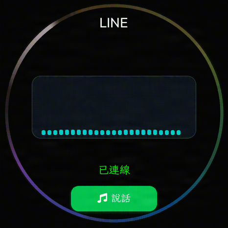
  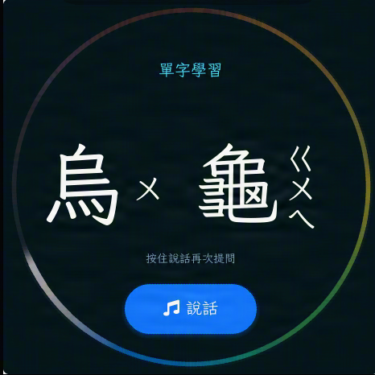
  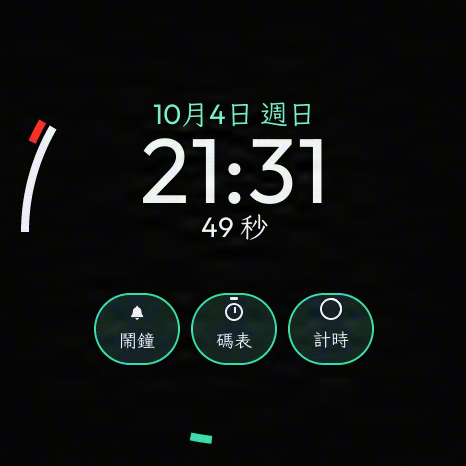

  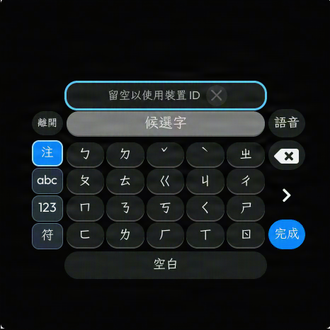
  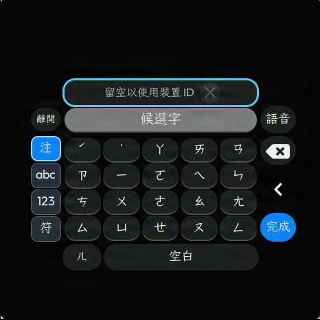
  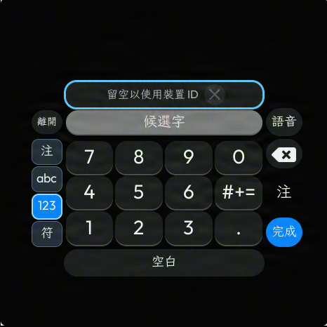
  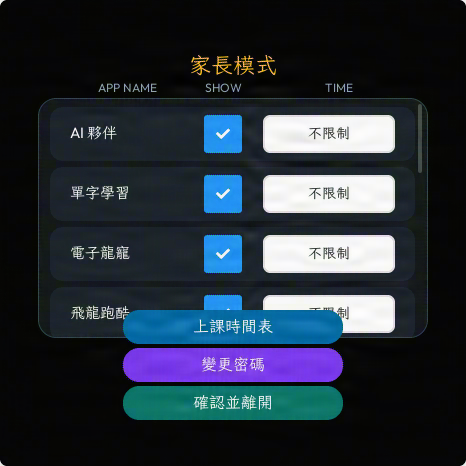

  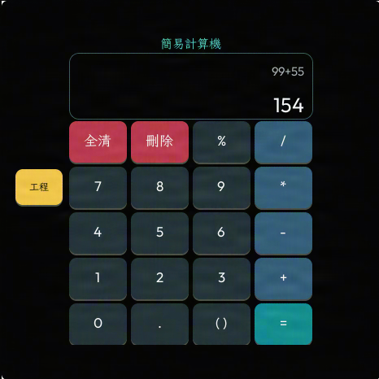
  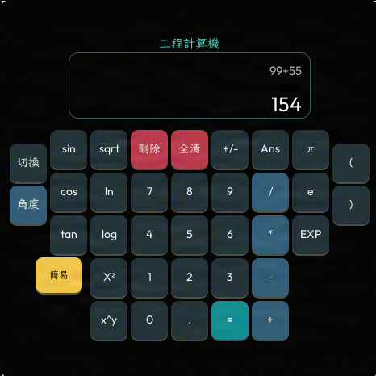
  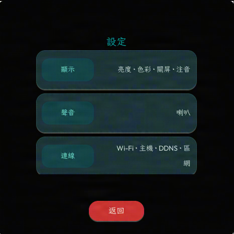

### 硬體

Dreamcloud 基於微雪的 [Waveshare ESP32-S3-Touch-AMOLED-1.75C](https://docs.waveshare.com/ESP32-S3-Touch-AMOLED-1.75C)。圓形螢幕、觸控、喇叭、麥克風、Wi‑Fi 和六軸感測都來自這塊板子。板子的公開說明、原理圖和原廠範例在微雪文件與 [waveshareteam/ESP32-S3-Touch-AMOLED-1.75C](https://github.com/waveshareteam/ESP32-S3-Touch-AMOLED-1.75C)。

| | |
| --- | --- |
| 開發板 | Waveshare ESP32-S3-Touch-AMOLED-1.75C |
| 主控 | ESP32-S3R8，最高 240 MHz |
| 螢幕 | 1.75 吋 466×466 AMOLED，CO5300，QSPI |
| 觸控 | CST9217 電容觸控 |
| 聲音 | 板載麥克風與喇叭 |
| 無線 | 2.4 GHz Wi‑Fi、Bluetooth 5 LE |
| 體感 | QMI8658 六軸感測（加速度計與陀螺儀） |
| 儲存 | 32 MB Flash、8 MB PSRAM |
| 介面 | USB Type-C，外殼可放電池 |

### App 圖示

  
  
  
  
  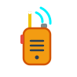
  
  
  

  
  
  
  
  
  
  

上排：AI 夥伴、AI 遙控、單字學習、電子龍寵、對講機、即時通、橋上跑者、小精靈。  
下排：炸彈人、猜拳、井字遊戲、時鐘、計算機、家長模式、設定。

### 最近的進度

完整日誌在官網的[更新與開發進度](https://dreamcloud.ccwu.cc/updates/)，討論區也有每天的紀錄。

- **10/26** 官網換上新的實機畫面。遊戲頁補上橋上跑者，計步頁換上新版健走與步數目標。
- **10/25** 橋上跑者可以邀請附近另一支裝置雙人合作。
- **10/21** Gemini、ChatGPT、Claude 可以直接在電腦端程式裡對話。健走多了每小時步數分布。
- **10/19** 按住電源鍵約 1 秒開機；長按約 6 秒可以強制關機。
- **10/16** 健走上線。Windows 電腦端程式收成一個檔案就能用。
- **10/13** 即時通可以在電腦端選擇要接哪一個通訊平台。

### 常見問題

**AI 是在裝置上離線運作的嗎？**  
不是。龍寵的照顧、飛行、對戰，以及小遊戲和工具，可以直接在裝置上用。跟龍說話、AI 夥伴對話，和遠端任務，需要網路和電腦端配套程式。AI 對話還需要你自己的 AI 服務帳號。

**龍寵會直接用 AI 跟我對話嗎？**  
會。龍孵出來之後，在主畫面按住說話，牠會聆聽，再用語音回你。需要網路和電腦端配套程式。龍還是蛋的時候，或正在飛行、對戰時，先不能對話。AI 夥伴仍然是另一個 App。

**適合小朋友用嗎？**  
有密碼保護的家長模式，可以設定 App 顯示和上課時段。介面也有注音。

**計步一定要戴在手上嗎？**  
不用。可以選手腕或口袋。距離是估計值。

**電腦端要裝什麼？**  
Windows 電腦端程式是一個檔案，雙擊就能用。AI 功能和鍵盤手把會用到它。即時通和手把也可以改用 Android 端程式。

**網站上的畫面是實機嗎？**  
是。還在開發中，正式版畫面可能會不一樣。

### 說給我們聽

不管是壞掉的地方、看不懂的地方，還是希望它會做的事，都很歡迎留言。不用註冊，訪客也能發文。

- [回報 Bug](https://dreamcloud.ccwu.cc/forum/?c=bug)
- [問問題](https://dreamcloud.ccwu.cc/forum/?c=question)
- [改善建議](https://dreamcloud.ccwu.cc/forum/?c=improvement)
- [許願](https://dreamcloud.ccwu.cc/forum/?c=feature)

[到討論區留言 →](https://dreamcloud.ccwu.cc/forum/)

### 圖片與著作權

本頁所有截圖、圖示與介面設計皆為 © 2026 Dreamcloud 團隊所有，保留所有權利，未以開放授權釋出。未經同意，請勿重製、轉載、改作，也不得用於 AI／機器學習訓練或生成仿作。圖片內含識別用數位標記。詳見 [COPYRIGHT.md](COPYRIGHT.md)。

## English

Dreamcloud has a round AMOLED screen under two inches, with a microphone and a speaker. A little dragon lives on it and grows when you look after it. Hold the button and talk to ask a question, or to hand a task to an AI assistant on your computer.

Progress and feedback live on the website: [dreamcloud.ccwu.cc](https://dreamcloud.ccwu.cc/).

### Website

Each area has its own page.

| | Page | What it covers |
| --- | --- | --- |
| 01 | [Dragon](https://dreamcloud.ccwu.cc/dragon/) | Raise it from an egg to an ancient dragon. Tilt-to-fly stages and duels |
| 02 | [AI Companion and AI Remote](https://dreamcloud.ccwu.cc/ai/) | Talk with an AI, or turn one sentence into a task for an assistant on your computer |
| 03 | [Steps and walking](https://dreamcloud.ccwu.cc/steps/) | Today's step ring, a 7-day chart, and a breakdown of each day |
| 04 | [Games](https://dreamcloud.ccwu.cc/games/) | A maze game, Bridge Runner, Bomber, rock-paper-scissors, and tic-tac-toe. A keyboard or phone can be the controller |
| 05 | [Other apps](https://dreamcloud.ccwu.cc/apps/) | Messenger, walkie-talkie, vocabulary, Zhuyin input, parent mode, and daily tools |
| 06 | [Updates](https://dreamcloud.ccwu.cc/updates/) | What changed, what is next, and common questions |
| 07 | [Forum](https://dreamcloud.ccwu.cc/forum/) | Bugs, questions, improvements, and wishes |

Round AMOLED under two inches · microphone and speaker · Wi‑Fi · motion and step counting · Traditional Chinese, Zhuyin, and English · parent mode

### What is inside

#### Dragon

Feed it, let it sleep, or hold to hug it. Life, hunger, mood, and stamina change with that care. The six stages are egg, baby, juvenile, youth, adult, and ancient dragon. Each dragon has its own personality, level, and evolution stage.

Tilt the device to fly through sky and forest stages. You can also duel an NPC dragon. While the home screen is open, a friend's duel invite can still arrive.

After it hatches, you can talk to the dragon. Hold to speak on its home screen, and it answers by voice. That voice goes through the computer companion and needs a network. It does not run offline on the device. The dragon cannot talk while it is still an egg, or during a flight stage or a duel. AI Companion is still a separate app.

[Dragon on the website →](https://dreamcloud.ccwu.cc/dragon/)

  
  
  
  
  

#### AI Companion and AI Remote

The companion listens while you hold to talk, then answers by voice. It connects to a mainstream AI service you choose. Voices include a Taiwanese accent, American English, and British English. If the network voice fails, a backup voice takes over. One reply is never switched to another voice halfway through.

AI Remote turns one sentence into a task for an AI assistant on your computer. Pick the assistant, dictate or type with Zhuyin, then confirm. A ring shows the wait. When it finishes, you can read the reply or hear a short spoken summary. Only assistants installed on that computer are listed. A pairing code is on by default, and you can turn it off on your home network. If you leave the screen, the reply comes back as a message bubble.

AI does not run offline on the device. It needs a network, the computer companion app, and your own AI account.

[AI on the website →](https://dreamcloud.ccwu.cc/ai/)

#### Steps and walking

Count steps on a wrist or in a pocket. If the sensor misses a moment, another method fills the gap. The launcher draws today's steps as a ring, and the navigation bar shows the count too. The step counter and the daily goal are separate settings. Walking time counts continuous walking only.

The walking app shows the last seven days as bars. Tap a day for steps, continuous walking time, estimated distance, goal progress, and the hourly spread. Distance is an estimate.

[Steps on the website →](https://dreamcloud.ccwu.cc/steps/)

  
  

#### Games

In the maze game, the mouth opens toward the way it moves. Tilt or swipe to steer, and you can queue the next turn. Each round starts with a countdown. The maze is orange-gold neon, and the music is original.

Bridge Runner can be played alone, or with a nearby second device. It has chapters, upper and lower paths, and checkpoints. Progress is still there the next time you open it.

Bomber, rock-paper-scissors, and tic-tac-toe are there too. A computer keyboard or an Android phone can be the controller for Bomber, dragon duel, the dragon map, and the maze game.

[Games on the website →](https://dreamcloud.ccwu.cc/games/)

  
  
  
  
  

#### Other apps

- **Messenger:** hold to talk. On the computer or Android app, connect LINE, Telegram, Discord, Slack, WhatsApp, WeCom, or Facebook Messenger.
- **Walkie-talkie:** pick a nearby friend, hold to talk, or send text.
- **Vocabulary:** see the word with Zhuyin, then hold and say it.
- **Zhuyin keyboard:** split into left and right halves so the keys are larger, with a separate number pad.
- **Parent mode:** a password gate for which apps appear, how long they can be used, and a class schedule.
- **Clock and calculator:** alarm, stopwatch, and timer; a simple calculator and a scientific one.
- **Settings:** Wi‑Fi, brightness, volume, device name, clock sync, and language. Boot reconnects to a remembered network. Hold the power key for about one second to turn on. If the screen sticks, hold it for about six seconds to force power off.

The Windows companion is one file. Double-click it, and the first launch walks through setup. The Android app can connect chat services, choose an English voice, and act as a game controller. Both show the firmware version on the device.

[Other apps on the website →](https://dreamcloud.ccwu.cc/apps/)

  
  
  
  

  
  
  
  

  
  
  

### Hardware

Dreamcloud is based on the Waveshare [ESP32-S3-Touch-AMOLED-1.75C](https://docs.waveshare.com/ESP32-S3-Touch-AMOLED-1.75C). The round display, touch, speaker, microphone, Wi‑Fi, and six-axis sensor come from that board. Waveshare's documentation, schematic, and factory examples are on their docs site and in [waveshareteam/ESP32-S3-Touch-AMOLED-1.75C](https://github.com/waveshareteam/ESP32-S3-Touch-AMOLED-1.75C).

| | |
| --- | --- |
| Board | Waveshare ESP32-S3-Touch-AMOLED-1.75C |
| MCU | ESP32-S3R8, up to 240 MHz |
| Display | 1.75-inch 466×466 AMOLED, CO5300, QSPI |
| Touch | CST9217 capacitive controller |
| Audio | Onboard microphone and speaker |
| Wireless | 2.4 GHz Wi‑Fi, Bluetooth 5 LE |
| Motion | QMI8658 six-axis IMU (accelerometer and gyroscope) |
| Memory | 32 MB flash, 8 MB PSRAM |
| Connector | USB Type-C. The case has room for a battery |

### App icons

Top row: AI Companion, AI Remote, vocabulary, pet dragon, walkie-talkie, messenger, Bridge Runner, maze game.  
Bottom row: Bomber, rock-paper-scissors, tic-tac-toe, clock, calculator, parent mode, settings.

The icons are in the [picture row above](#app-icons).

### Recent progress

The full log is on the [updates page](https://dreamcloud.ccwu.cc/updates/). The forum has the day-by-day notes.

- **Oct 26** New device screenshots on the website, including Bridge Runner and the walking goals.
- **Oct 25** Bridge Runner can invite a nearby device for co-op.
- **Oct 21** Gemini, ChatGPT, and Claude can talk inside the computer app. Walking gained an hourly step chart.
- **Oct 19** Hold the power key for about one second to turn on. Hold for about six seconds to force power off.
- **Oct 16** The walking app arrived. The Windows companion became a single file.
- **Oct 13** Messenger can choose which chat service to connect, from the computer app.

### Questions

**Does AI run offline on the device?**  
No. Feeding, flights, duels, the games, and the tools run on the device. Talking with the dragon, the AI companion, and remote tasks need a network and the computer companion. AI conversation also needs your own AI account.

**Does the dragon talk through the AI?**  
Yes. After it hatches, hold to talk on its home screen. It listens and answers by voice. That needs a network and the computer companion. It cannot talk while it is still an egg, or during a flight stage or a duel. AI Companion is still a separate app.

**Can a child use it?**  
Parent mode is behind a password. It can hide apps and set class hours. The interface includes Zhuyin.

**Do steps require a wrist?**  
No. Wrist and pocket modes are both available. Distance is an estimate.

**What does the computer need?**  
One Windows file. Double-click it. AI features and the keyboard controller use it. Messenger and the controller can use the Android app instead.

**Are the pictures from a real device?**  
Yes. This is a development build, so the finished screens may change.

### Tell us

Bugs, confusing spots, and things you wish it could do are all welcome. Guests can post without an account.

- [Report a bug](https://dreamcloud.ccwu.cc/forum/?c=bug)
- [Ask a question](https://dreamcloud.ccwu.cc/forum/?c=question)
- [Suggest an improvement](https://dreamcloud.ccwu.cc/forum/?c=improvement)
- [Make a wish](https://dreamcloud.ccwu.cc/forum/?c=feature)

[Open the forum →](https://dreamcloud.ccwu.cc/forum/)

### Images and copyright

All screenshots, icons and interface designs on this page are © 2026 Dreamcloud team, all rights reserved, and are not released under an open license. Do not copy, repost or adapt them, or use them for AI / machine-learning training or generative imitation, without permission. Images carry identifying digital marks. See [COPYRIGHT.md](COPYRIGHT.md).
